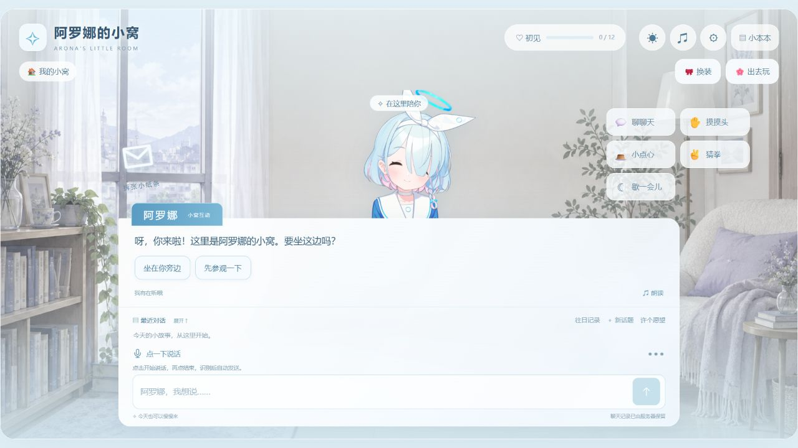
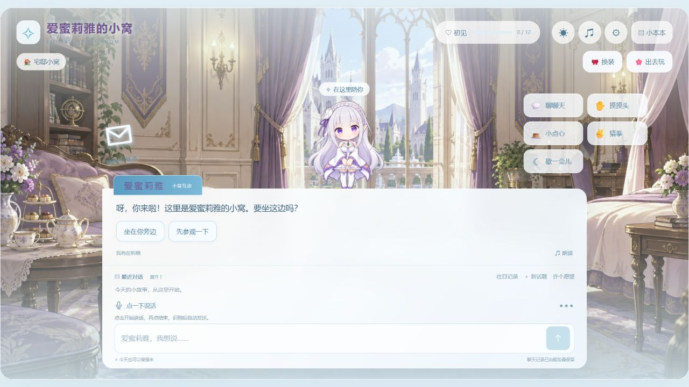
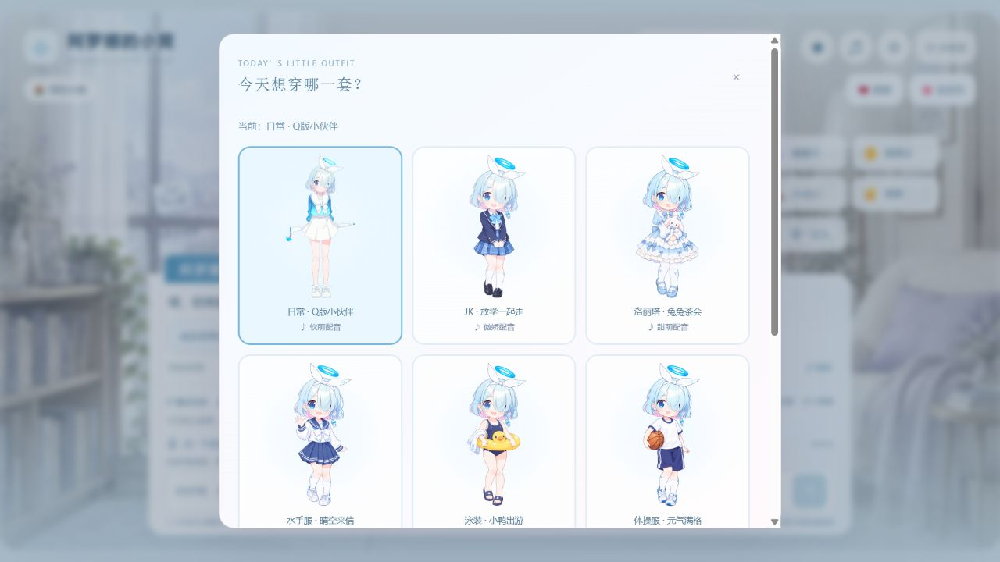
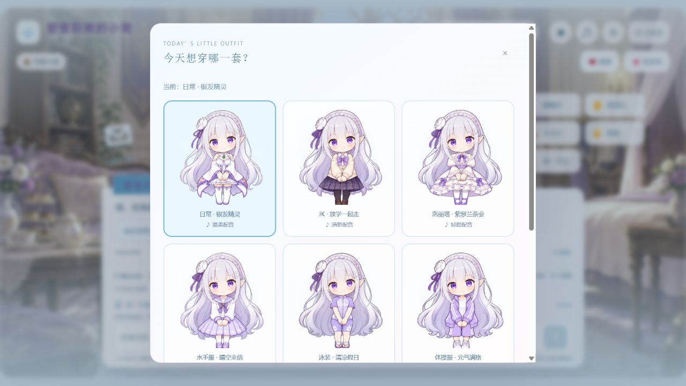
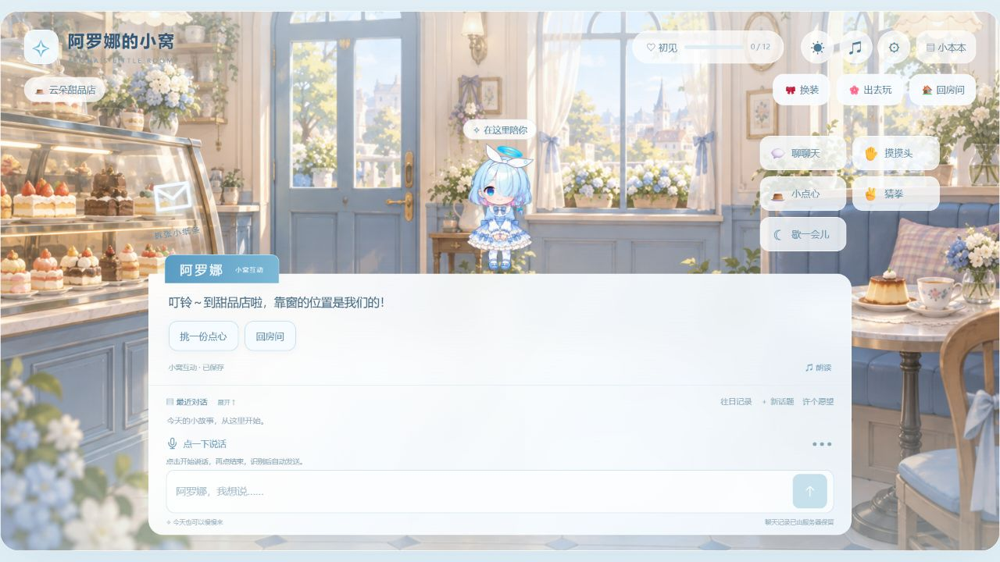
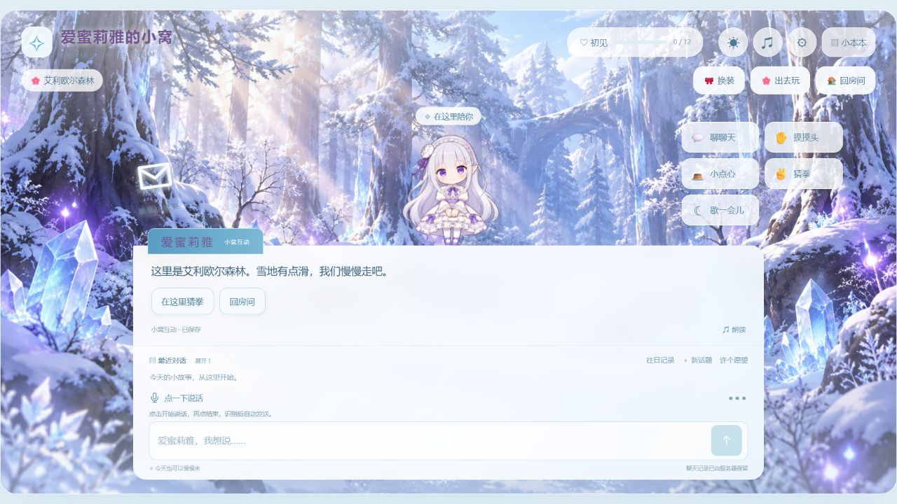

# 陪伴助理 · Companion Assistant

一个可以聊天、换装、听音乐，也能帮你记住日常小事的角色生活助理。

**摸摸头，换身衣服，出去逛逛。回来之后，重要的小事交给小本本。**

[阿罗娜的小窝](arona/README.md) · [爱蜜莉雅的小窝](emilia/README.md) · [快速开始](#快速开始) · [素材说明](#许可证与素材)

## 先看看小窝

| 阿罗娜 · 蓝白色的日常 | 爱蜜莉雅 · 银发精灵的宅邸 |
| :---: | :---: |
| [](arona/README.md) | [](emilia/README.md) |
| 聊天、摸头、点心、猜拳、记事与待办 | 温柔配音、主题场景、记事和物品位置查找 |

图片可点开查看对应版本的完整介绍。以下界面来自公开源码的实际本地运行，笔记、钥匙位置等内容均为临时演示数据。

## 今天想穿哪一套？

两套小窝都有独立衣柜。换好衣服之后，眨眼、招手、吃点心、猜拳等动作仍然可以继续；不同服装还有各自的预设配音。

| 阿罗娜的衣柜 | 爱蜜莉雅的衣柜 |
| :---: | :---: |
|  |  |

<details>
<summary>展开看看角色立绘</summary>

<table>
<tr><th>阿罗娜 · JK</th><th>阿罗娜 · 洛丽塔</th><th>爱蜜莉雅 · 日常</th><th>爱蜜莉雅 · 洛丽塔</th></tr>
<tr>
<td align="center"></td>
<td align="center"></td>
<td align="center"></td>
<td align="center"></td>
</tr>
</table>

</details>

## 换个地方，待一会儿

| 一起去甜品店 | 在艾利欧尔森林散步 |
| :---: | :---: |
|  |  |

场景会切换背景与对应 BGM，也可以回房间看雨、看星空。待机约 25–35 秒后会随机轻哼；浏览器可能需要先点击一次页面才能播放声音。

## 陪伴，也帮你记住一点东西

- **随口聊聊**：文字聊天、麦克风输入、回复朗读；普通回复以简短自然为主。
- **互动一下**：摸头、点心、猜拳、拆纸条和好感内容解锁。
- **写进小本本**：记事、待办、修改记录、查旧聊天。
- **东西放哪了**：爱蜜莉雅版支持“钥匙放在玄关第二个抽屉”→“钥匙在哪”，并能查看位置历史。


这里只报告用户记录过的内容，不追踪现实位置，也不提供关闭网页后的推送或定时通知。未支持的功能会明确提示，不假装执行成功。

## 快速开始

需要 **Node.js 24+**。使用原生前端、Node 内置 SQLite，没有第三方运行依赖，不需要 `npm install`。

```sh
git clone https://github.com/takagi137/companion-assistant.git
cd companion-assistant

# 选择一个版本启动
npm run start:arona
# 或在另一个终端运行
npm run start:emilia
```

| 版本 | 本地地址 | 详细介绍 |
| --- | --- | --- |
| 阿罗娜 | http://127.0.0.1:4173/#room | [arona/README.md](arona/README.md) |
| 爱蜜莉雅 | http://127.0.0.1:4174/#room | [emilia/README.md](emilia/README.md) |

**先不配 Key 也能玩**：预设互动、换装、场景音乐、小本本和已有音频可以直接体验；爱蜜莉雅的常用物品记录与查询句式也可直接使用。

自由聊天、语音识别和新台词的实时配音需要自己的阿里云百炼 Key 与可用模型额度。将对应目录的 `.env.example` 复制为 `.env` 后填写；两个小窝各自保留配置与数据库。

## 配置、部署与开发

- `.env`：模型、Key、口令、端口与网站域名；不要把凭据填到前端。
- `deploy.env`：可选的服务器地址和部署目录，参考 `deploy.env.example`。
- 实际配置、聊天记录与数据库不提交 Git。公开部署需要 HTTPS、独立口令和持久化数据卷。
- [阿罗娜部署](arona/DEPLOYMENT.md) · [爱蜜莉雅部署](emilia/DEPLOYMENT.md)
- 测试：`npm run test:arona` / `npm run test:emilia`。
- 历史实现与验证记录：[阿罗娜](arona/DEVELOPMENT-HISTORY.md) / [爱蜜莉雅](emilia/DEVELOPMENT-HISTORY.md)。

## 许可证与素材

原创代码采用 [MIT](LICENSE)，作者署名 takagi137。角色及第三方素材权利不因代码开源转移；本项目为爱好者作品，与原作官方无关联。

图片、配音和音乐按各自来源说明使用；保留各 `dist/assets/**/sources.json`、[爱蜜莉雅素材清单](emilia/ASSET-SOURCES.json) 中的来源、作者与许可信息，CC BY 音乐须保留署名。场景和换装包含 AI 同人演绎，不是官方游戏内容。
